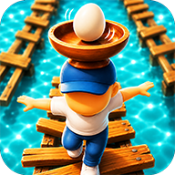
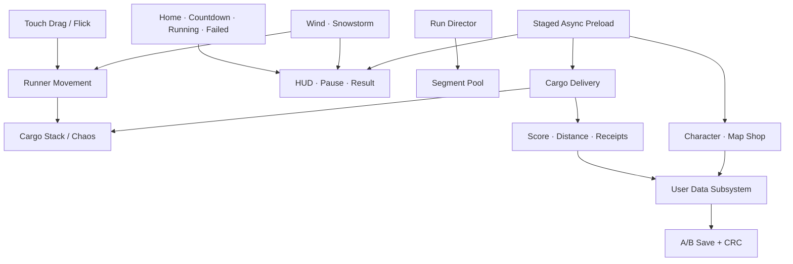

<p align="center">
  
</p>

<h1 align="center">Go Deliver!</h1>

<p align="center">
  <strong>머리 위 배달물을 지키며 달리는 3D 무한 밸런스 러너</strong>
</p>

<p align="center">
  AI Native Game Client Portfolio
</p>

<p align="center">
  
  
  
  
</p>

## Project

**Go Deliver!**는 자동으로 전진하는 러너의 중심을 조절하고, 머리 위에 계속 쌓이는 배달물을 떨어뜨리지 않도록 지켜내는 Android 게임입니다.

일반적인 러너의 속도 경쟁보다 **중심을 잃을 듯한 불안정함**에 집중했습니다. 좌우 드래그와 세 방향 플릭이라는 단순한 입력이 캐릭터의 자세, 적재물의 Chaos 물리 반응, 바람과 눈보라, 트랙 구조와 결합하면서 매번 다른 위기 상황을 만듭니다.

> **Design Goal**
>
> 입력은 단순하게, 결과는 예측 가능하지만 긴장감 있게.

- **Genre** — Mobile 3D Infinite Balance Runner
- **Engine** — Unreal Engine 5.6.1
- **Platform** — Android
- **Tech** — C++, Blueprint, UMG, Chaos Physics, Enhanced Input
- **Development** — 1인 AI Native 프로젝트
- **Ownership** — 게임 기획, 시스템 구조, 아키텍처, 기술 의사결정, 통합 검증

## Player Experience

```text
Balance → Jump → Protect Cargo → Complete Delivery → Earn Receipts → Unlock Content
```

- 좌우 드래그로 캐릭터의 중심을 이동시키고 적재물의 흔들림을 제어합니다.
- 왼쪽·오른쪽·위 플릭으로 측면 점프와 제자리 점프를 구분합니다.
- 배달물은 플레이 중 계속 투입되며, 정해진 시간 동안 지켜내면 배송이 완료됩니다.
- Wind와 Snowstorm은 속도 증가 대신 입력과 물리 상태를 흔들어 난이도를 만듭니다.
- 획득한 영수증으로 캐릭터와 맵을 구매하고 장착할 수 있습니다.
- Home부터 Run, Result, Retry, Shop과 맵 전환까지 하나의 모바일 플레이 루프로 연결됩니다.

## What I Designed

### Balance Runner

자동 전진, 드래그 기반 중심 이동, 플릭 점프를 하나의 이동 컴포넌트 안에서 상태별로 분리했습니다. 입력 요청과 실제 이동 시작을 구분해 점프 사운드, 입력 버퍼, 낙하 실패가 서로 충돌하지 않도록 설계했습니다.

### Cargo as the Core Mechanic

적재물은 단순한 점수 오브젝트가 아니라 목표이자 난이도입니다. `Hold → GuidedDrop → PhysicsCargo` 단계로 투입 연출의 일관성을 확보한 뒤 Chaos 물리로 전환해, 플레이어의 중심 이동과 환경 이벤트가 실제 흔들림으로 이어지게 했습니다.

### Data-driven Infinite Run

트랙 세그먼트, 맵, 적재물 후보와 이벤트 표현 리소스를 DataAsset으로 분리했습니다. 런타임에서는 세그먼트를 풀링하고, 실제 열린 맵의 콘텐츠 계약을 검증해 시스템 코드를 바꾸지 않고도 새로운 조합을 추가할 수 있습니다.

### Complete Client Loop

Home, Countdown, Run HUD, Pause, Result, Settings, Tutorial, 캐릭터·맵 상점을 하나의 상태 흐름으로 구성했습니다. 레벨 이동과 정산 경계를 명확히 해 Retry와 Home 전환을 반복해도 보상이나 UI가 중복되지 않도록 했습니다.

## Selected Engineering Cases

### 01. 저사양 기기의 초기 메모리 피크

**Problem**

앱 시작 시 판매 콘텐츠와 플레이 리소스를 한 번에 예열하면 첫 화면 이전의 메모리 피크가 커졌습니다.

**Decision**

예열 범위를 `Home / Run / Shop / Tutorial`로 분리했습니다. 최초에는 Home과 현재 장착 스킨만 준비하고, Run은 Home 표시 후 백그라운드에서, Shop과 Tutorial은 최초 진입 요청 시 준비합니다.

**Result**

첫 화면에 필요하지 않은 캐릭터·맵·튜토리얼 리소스의 초기 점유를 제거하면서도 START 이후 필요한 UI, VFX와 SFX의 준비 상태를 보장했습니다.

### 02. SaveGame 중단과 손상 복구

**Problem**

단일 SaveGame을 직접 덮어쓰면 저장 도중 종료되거나 파일이 손상됐을 때 영수증, 구매 목록과 장착 상태를 함께 잃을 수 있었습니다.

**Decision**

사용자 데이터를 A/B 슬롯에 교대로 기록하고, Generation과 CRC32를 가진 envelope로 감쌌습니다. 새 슬롯은 raw readback과 역직렬화 검증을 통과한 뒤에만 최신 상태로 확정합니다.

**Result**

최신 슬롯이 손상되면 직전 정상 스냅샷으로 돌아가고, 양쪽이 모두 손상된 경우에만 안전하게 신규 데이터로 초기화됩니다.

### 03. 물리 재미와 공정한 실패의 균형

**Problem**

저프레임에서 적재물이 물리로 전환되는 순간 바구니를 뚫거나 뒤로 처지면서 플레이어가 개입하기 전에 실패할 수 있었습니다.

**Decision**

투입 구간은 결정적인 GuidedDrop으로 처리하고, Chaos 전환 직후 짧은 시간 동안 Z축과 중력만 안정화했습니다. XY 흔들림과 회전은 유지해 핵심 물리 감각을 보존했습니다.

**Result**

프레임 변화에 따른 불공정한 즉시 실패를 줄이면서도 적재물이 무너질 듯 흔들리는 게임의 핵심 긴장감은 유지했습니다.

### 04. UMG와 C++의 책임 분리

**Problem**

레이아웃을 C++ fallback과 Widget Blueprint 양쪽에서 만들면 화면 원본이 둘로 갈리고 모바일 해상도 대응이 어려워집니다.

**Decision**

Widget Blueprint가 앵커, Safe Zone, 폰트와 브러시를 소유하고, C++은 `BindWidget`을 통해 데이터 주입, 상호작용, 상태 전환과 애니메이션만 담당하도록 기준을 통일했습니다.

**Result**

디자인 수정은 Blueprint 안에서 완결되고, 클라이언트 로직은 재사용 가능한 C++ 클래스에 남는 명확한 협업 경계를 만들었습니다.

## Client Architecture



GameMode는 플레이 상태만 소유하고, 이동·적재물·트랙·이벤트·사용자 데이터는 각 도메인 컴포넌트와 Subsystem으로 분리했습니다. UI는 상태를 표현하고 입력을 전달하며, 보상과 저장은 UserData의 단일 트랜잭션 경계에서 처리합니다.

## AI Native Ownership

Go Deliver!는 AI를 코드 자동완성 도구가 아니라 **구현 에이전트**로 사용한 프로젝트입니다.

- 프로젝트 소유자가 게임의 목표, 기능 우선순위, 시스템 구조와 아키텍처를 설계했습니다.
- 구현 전에 상태 책임, 저장 경계, 모바일 비용과 실패 조건을 검토하고 완료 기준을 결정했습니다.
- AI 에이전트는 결정된 설계를 바탕으로 C++ 구현, Blueprint 연동, 리팩터링, 문서화와 자동 검증을 수행했습니다.
- 결과물은 실제 코드·에셋·빌드 결과를 다시 대조하고, 요구사항과 다른 구현은 수정하는 반복 검증 방식으로 완성했습니다.

이 프로젝트에서 보여주고자 하는 역량은 직접 입력한 코드의 양이 아니라 **문제를 정의하고, 구조를 선택하고, AI가 구현한 결과를 검증해 하나의 동작하는 클라이언트로 통합하는 능력**입니다.

## Outcome

- Home → Countdown → Run → Result → Retry/Home의 전체 게임 루프 구현
- 캐릭터·맵 미리보기, 구매, 장착과 영수증 기반 사용자 데이터 구현
- 무한 트랙 풀링, Cargo Delivery와 RunEvent의 데이터 중심 확장 구조 구현
- 단계별 비동기 예열과 A/B CRC 저장 복구 적용
- `ProjectGEditor Win64 Development` 빌드 성공
- 전체 Blueprint 컴파일 오류 0, 경고 0, 로드 실패 0
- Android arm64 Build / Cook / Stage / Package / Archive 완료

## Assets & Project Identity

프로젝트에 포함된 외부 에셋은 무료로 사용할 수 있는 에셋이거나 프로젝트 소유자가 직접 제작한 에셋입니다.

사용자에게 보이는 프로젝트명은 **Go Deliver!**입니다. 저장소, `.uproject`, C++ 모듈과 저장 식별자에는 기존 에셋 참조와 SaveGame 호환성을 위해 `ProjectG`를 유지합니다.
