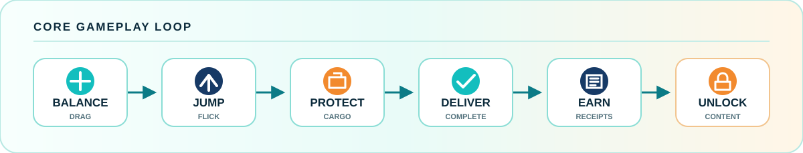
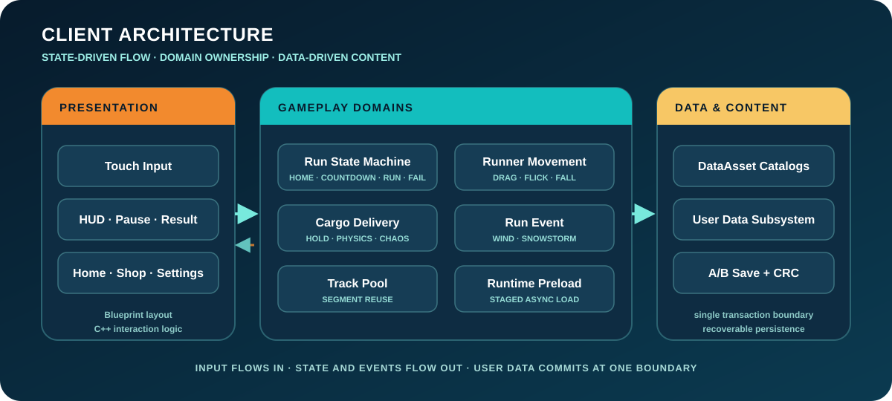

# Go Deliver!

**머리 위 배달물을 지키며 달리는 3D 무한 밸런스 러너**

자동으로 전진하는 러너의 중심을 조절하고, 계속 쌓이는 배달물을 떨어뜨리지 않도록 지켜냅니다. 속도 경쟁보다 **중심을 잃을 듯한 불안정함**과 물리적 긴장감에 집중했습니다.

[게임 경험](#게임-경험) · [설계 범위](#설계한-클라이언트) · [기술 사례](#대표-기술-사례) · [아키텍처](#클라이언트-아키텍처) · [AI Native](#ai-native-역할과-책임)

| 간결한 입력 | 물리적 긴장감 | 완성형 클라이언트 루프 |
|:---:|:---:|:---:|
| 좌우 드래그 + 세 방향 플릭 | 누적 적재물 + Chaos 반응 | Run · Result · Shop · Save |

## 게임 경험

| 01 · Balance | 02 · Flick Jump | 03 · Protect Cargo |
|:---|:---|:---|
| 좌우 드래그가 캐릭터의 중심과 적재물 흔들림에 함께 영향을 줍니다. | 왼쪽·오른쪽·위 플릭을 측면 점프와 제자리 점프로 구분합니다. | 배송 시간이 끝날 때까지 적재물을 지키면 점수와 영수증을 획득합니다. |

> **Design Goal**
>
> 입력은 단순하게, 결과는 예측 가능하지만 긴장감 있게.

Wind와 Snowstorm은 단순한 속도 상승 대신 입력과 물리 상태를 흔듭니다. 위험 세그먼트와 누적 적재물이 결합하면서 같은 조작으로도 계속 다른 압박을 만듭니다.

## 설계한 클라이언트

| Balance Runner | Cargo Delivery |
|:---|:---|
| 자동 전진, 드래그 기반 중심 이동, 플릭 점프를 상태별로 분리했습니다. 입력 요청과 실제 이동 시작을 구분해 입력 버퍼·사운드·낙하 판정의 충돌을 막았습니다. | `Hold → GuidedDrop → PhysicsCargo` 흐름으로 투입 연출의 일관성을 확보한 뒤 Chaos 물리로 전환합니다. |
| **Data-driven Infinite Run** | **Complete Client Loop** |
| 트랙·맵·적재물·이벤트를 DataAsset으로 분리하고 세그먼트를 풀링해 콘텐츠 조합을 확장할 수 있게 했습니다. | Home, Countdown, HUD, Pause, Result, Settings, Tutorial, 캐릭터·맵 상점을 하나의 상태 흐름으로 연결했습니다. |

## 대표 기술 사례

<strong>01 · 저사양 기기 초기 메모리 피크</strong> — 단계별 비동기 예열로 첫 화면 비용 분리

| | 내용 |
|:---|:---|
| **Problem** | 판매 콘텐츠와 플레이 리소스를 한 번에 예열하면서 첫 화면 이전의 메모리 피크가 커졌습니다. |
| **Decision** | 예열을 `Home / Run / Shop / Tutorial`로 나누고 현재 화면에 필요한 그룹만 순차적으로 준비했습니다. |
| **Result** | 초기 점유를 낮추면서 START 이후 필요한 UI, VFX와 SFX의 준비 상태를 보장했습니다. |

<strong>02 · SaveGame 손상 복구</strong> — A/B 교대 저장과 CRC32 검증

| | 내용 |
|:---|:---|
| **Problem** | 단일 파일 덮어쓰기는 저장 중단 시 영수증, 구매 목록과 장착 상태를 함께 잃을 수 있었습니다. |
| **Decision** | Generation과 CRC32를 가진 envelope를 A/B 슬롯에 교대로 기록하고 raw readback까지 검증했습니다. |
| **Result** | 최신 슬롯 손상 시 직전 정상 스냅샷으로 돌아가며, 양쪽 손상에만 신규 데이터로 초기화됩니다. |

<strong>03 · 물리 재미와 공정한 실패</strong> — 축별 안정화로 Chaos 감각 보존

| | 내용 |
|:---|:---|
| **Problem** | 저프레임에서 물리 전환 직후 적재물이 튀며 플레이어가 개입하기 전에 실패할 수 있었습니다. |
| **Decision** | 투입은 GuidedDrop으로 처리하고 Chaos 전환 직후 Z축과 중력만 짧게 안정화했습니다. |
| **Result** | 불공정한 즉시 실패를 줄이면서 XY 흔들림과 회전의 물리 긴장감은 유지했습니다. |

<strong>04 · UMG와 C++ 책임 분리</strong> — 디자인 원본과 실행 로직의 경계 확립

| | 내용 |
|:---|:---|
| **Problem** | C++ fallback과 Widget Blueprint가 동시에 레이아웃을 소유하면 화면 원본이 둘로 갈립니다. |
| **Decision** | Blueprint는 레이아웃·Safe Zone·스타일을, C++은 `BindWidget` 기반 상태·데이터·애니메이션을 담당하게 했습니다. |
| **Result** | 디자인 수정은 Blueprint에서 완결되고 클라이언트 로직은 재사용 가능한 C++에 남습니다. |

## 클라이언트 아키텍처

GameMode는 플레이 상태만 소유하고 이동·적재물·트랙·이벤트·사용자 데이터는 각 도메인 컴포넌트와 Subsystem으로 분리했습니다. UI는 상태를 표현하고 입력을 전달하며, 보상과 저장은 UserData의 단일 트랜잭션 경계에서 처리합니다.

## AI Native 역할과 책임

| 프로젝트 소유자 | AI 구현 에이전트 |
|:---|:---|
| 게임 목표와 플레이 경험 정의 | 결정된 설계의 C++ 구현 |
| 기능 우선순위와 완료 기준 결정 | Blueprint와 DataAsset 연동 |
| 시스템 구조와 아키텍처 설계 | 리팩터링과 문서 동기화 |
| 모바일 비용과 트레이드오프 판단 | 빌드·정적 검사 자동화 |
| 구현 결과 통합 검증 | 검증 결과에 따른 반복 수정 |

이 프로젝트에서 보여주고자 하는 역량은 직접 입력한 코드의 양이 아니라 **문제를 정의하고, 구조를 선택하고, AI가 구현한 결과를 검증해 하나의 동작하는 클라이언트로 통합하는 능력**입니다.

## 결과

| `4 STATES` | `0 / 0 / 0` | `A/B + CRC` | `ARM64` |
|:---:|:---:|:---:|:---:|
| Home · Countdown · Running · Failed | Blueprint 오류 · 경고 · 로드 실패 | 복구 가능한 User Data | Android Build · Cook · Package |

- Home → Countdown → Run → Result → Retry/Home 전체 게임 루프
- 캐릭터·맵 미리보기, 구매, 장착과 영수증 기반 사용자 데이터
- 무한 트랙 풀링, Cargo Delivery와 RunEvent의 데이터 중심 확장 구조
- `ProjectGEditor Win64 Development` 빌드 및 Android arm64 파이프라인 검증

<strong>에셋 및 프로젝트 식별자</strong>

프로젝트에 포함된 외부 에셋은 무료로 사용할 수 있는 에셋이거나 프로젝트 소유자가 직접 제작한 에셋입니다.

사용자에게 보이는 프로젝트명은 **Go Deliver!**입니다. 저장소, `.uproject`, C++ 모듈과 저장 식별자에는 기존 에셋 참조와 SaveGame 호환성을 위해 `ProjectG`를 유지합니다.

